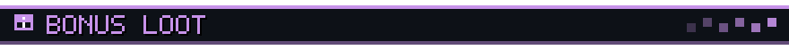

<div align="center">

<a href="https://github.com/NahwaKakaa?tab=repositories">
  
</a>


<a href="mailto:13020230187@student.umi.ac.id"></a>
<a href="https://github.com/NahwaKakaa?tab=repositories"></a>


</div>

<br />


```yaml
player:   Nahwa Kakaa
class:    Computer Science Student
guild:    Fakultas Ilmu Komputer, Universitas Muslim Indonesia
spawn:    Makassar, Indonesia
main:     Web Development (Laravel, PHP, Tailwind CSS)
side:     UI/UX Design (Figma)
training: C++ fundamentals, Machine Learning workflows
status:   Open for co-op (campus projects & open source)
motto:    "give me something that's not boring."
```


<div align="center">
  
  <br /><br />
  
</div>

<br />


<div align="center">
  <a href="https://github.com/NahwaKakaa/skrining-tb-web"></a>
  <a href="https://github.com/NahwaKakaa/sar-inventory"></a>
  <a href="https://github.com/NahwaKakaa/Voting-SistemTerdistribusi"></a>
  <a href="https://github.com/NahwaKakaa/SmartAbsen-WEB"></a>
  <a href="https://github.com/NahwaKakaa/LaporTuntas-UIUX"></a>
  <a href="https://github.com/NahwaKakaa/Pengenalan-Pemrograman-26-27"></a>
  <br />
  <sub>🖱️ Click any quest card to open the repository</sub>
</div>

<br />


<div align="center">
  
  
</div>

<br />


<div align="center">
  
  <br />
  <sub>Updated daily by GitHub Actions</sub>
</div>

<br />



<details>
<summary><b>🎁 Click to open the treasure chest</b></summary>
<br />

| Item | Description |
|---|---|
| 🧭 **Currently exploring** | C++ fundamentals, Laravel, and UI/UX case studies |
| 🛠️ **Favorite tools** | VS Code, Antigravity, Figma, GitHub |
| 🏆 **Side quests** | UI/UX competitions and campus projects |
| 💬 **Ask me about** | Web development, Figma, and C++ practicum |
| 🤝 **Party invite** | Open to collaborate. Send a message anytime! |

</details>

<br />


