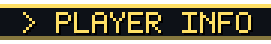
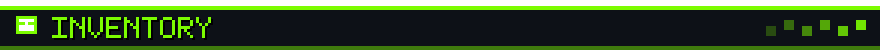
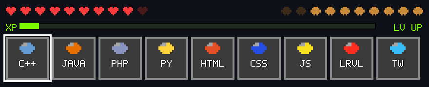
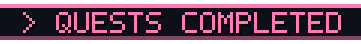
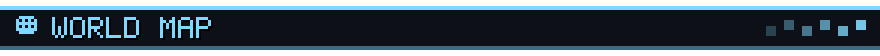
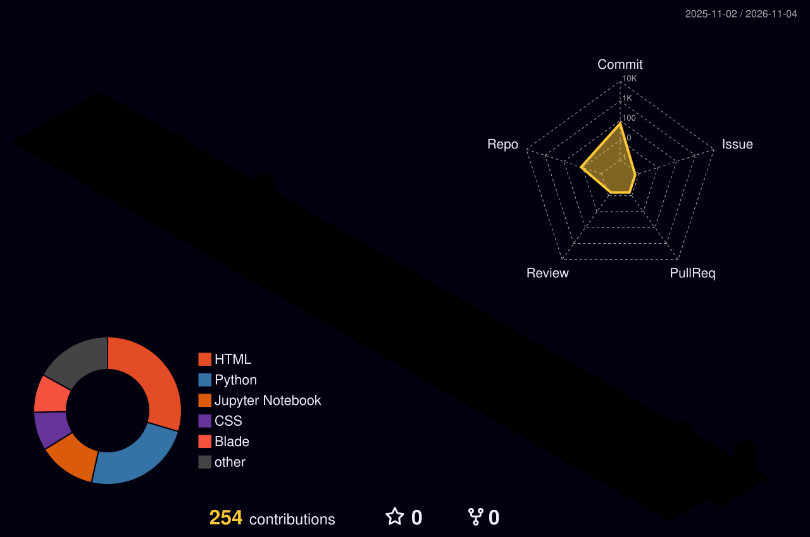
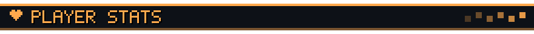

<div align="center">




<a href="mailto:13020230187@student.umi.ac.id"></a>


</div>

<br />



```yaml
player:   Nahwa Kakaa
class:    Computer Science Student
guild:    Fakultas Ilmu Komputer, Universitas Muslim Indonesia
spawn:    Makassar, Indonesia
main:     Web Development (Laravel, PHP, Tailwind CSS)
training: C++ fundamentals, Machine Learning workflows
status:   Open for co-op (campus projects & open source)
motto:    "give me something that's not boring."
```



<div align="center">
  
  <br /><br />
  
</div>



| | Quest | Reward |
|:-:|---|---|
| 🩺 | [**skrining-tb-web**](https://github.com/NahwaKakaa/skrining-tb-web) — web-based tuberculosis screening app | `Web` |
| 🎒 | [**sar-inventory**](https://github.com/NahwaKakaa/sar-inventory) — inventory system for SAR equipment | `Web` |
| 🗳️ | [**Voting-SistemTerdistribusi**](https://github.com/NahwaKakaa/Voting-SistemTerdistribusi) — voting app for Distributed Systems | `Distributed` |
| 🕒 | [**SmartAbsen-WEB**](https://github.com/NahwaKakaa/SmartAbsen-WEB) — smart attendance web app | `Web` |
| 🐟 | [**EcommerceCatFish**](https://github.com/NahwaKakaa/EcommerceCatFish) — e-commerce site for catfish products | `PHP` |
| ⚔️ | [**Pengenalan-Pemrograman-26-27**](https://github.com/NahwaKakaa/Pengenalan-Pemrograman-26-27) — programming practicum case studies | `C++` |



<div align="center">
  
  <br />
  
</div>



<div align="center">
  
  
  <br />
  
</div>

<div align="center">
  <br />
  <sub>💾 GAME SAVED · Thanks for visiting, traveler! Drop a ⭐ on any quest you like.</sub>
</div>
